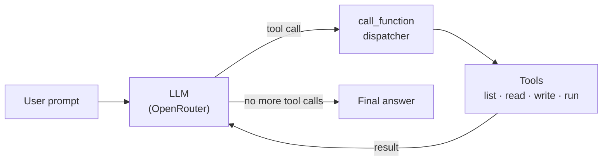

# aiagent

**A command-line AI coding agent that can explore, edit and run code in a project directory.**

You give it a task in plain English. It plans the steps, calls tools to list files, read code, write changes and run Python, looks at the results, and repeats until the task is done. Built in Python with the OpenAI SDK pointed at [OpenRouter](https://openrouter.ai), as part of the [Boot.dev](https://www.boot.dev) backend curriculum.

```bash
uv run main.py "fix the bug: 3 + 7 * 2 should be 17, not 20"
```

---

## How it works



1. The user's prompt and a system prompt go to the model, along with JSON schemas describing four tools.
2. If the model replies with tool calls, the dispatcher runs each one and appends the result to the conversation.
3. The updated conversation goes back to the model, which decides the next step.
4. The loop ends when the model answers without calling a tool, or after **20 iterations** as a safety stop.

The system prompt tells the model to plan in steps, start by scanning the directory rather than asking where code lives, and run both the tests and the app after making changes.

## Tools

| Tool | What it does | Limits |
| --- | --- | --- |
| `get_files_info` | Lists a directory's contents with file sizes | Inside the working directory only |
| `get_file_content` | Reads a file | Truncated at 10,000 characters |
| `write_file` | Creates or overwrites a file | Inside the working directory only |
| `run_python_file` | Runs a Python file with optional arguments and returns stdout, stderr and exit code | `.py` files only, 30-second timeout |

## Guardrails

- **The model never chooses the working directory.** The dispatcher injects it into every tool call from config, so a prompt can't redirect the agent elsewhere.
- **Path traversal is blocked.** Every tool resolves the requested path and checks it with `os.path.commonpath` against the working directory, so inputs like `../../etc/passwd` are rejected.
- **Bounded execution.** Script runs time out after 30 seconds, file reads are capped, and the agent loop stops after 20 rounds.
- **Errors go back to the model as text** instead of crashing the agent, so it can see what went wrong and adjust.

These are guardrails, not a full sandbox: scripts still run with the user's own permissions, so only point the agent at code you trust.

## Project layout

```
main.py            # CLI entry point and the agent loop
call_function.py   # Maps tool calls from the model to Python functions
prompts.py         # System prompt
config.py          # Working directory, read limit, max iterations
functions/         # The four tools, each with its JSON schema
calculator/        # Sample project the agent works on
test_*.py          # Scripts that exercise each tool, including blocked paths
```

## Running it

**Requirements:** Python 3.13+, [uv](https://docs.astral.sh/uv/), and an [OpenRouter API key](https://openrouter.ai/keys).

```bash
git clone https://github.com/ayubmja2/aiagent-bootdev.git
cd aiagent-bootdev
echo "OPENROUTER_API_KEY=your-key-here" > .env

uv run main.py "what files are in the calculator project?"
uv run main.py "run the calculator tests and fix anything that fails" --verbose
```

`--verbose` prints each tool call with its arguments, the tool results and token usage.

## What I learned

- How function calling works under the hood: tool schemas, tool-call IDs, and feeding results back into the message history
- Why an agent needs hard limits: an iteration cap, timeouts and truncation keep a confused model from looping or flooding its own context
- Treating every model output as untrusted input, the same way you'd treat user input in a web API

## Author

**Ayub Ali** · [GitHub](https://github.com/ayubmja2) · [LinkedIn](https://www.linkedin.com/in/ayubmja/)
